# PKarchives

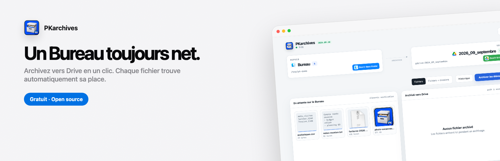

[🇫🇷 FR](README.md) · [🇬🇧 EN](README_en.md)

**Version du projet : 2026.10.73** · App disponible : 2026.10.27 · [Changelog](CHANGELOG.md) · [Licence MIT](LICENSE)

Archive du Bureau vers Google Drive via rclone, avec interface macOS et interface CLI/TUI.

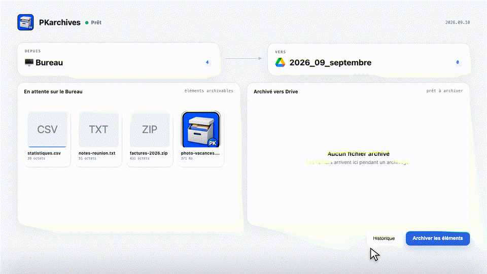

## Structure

```text
src/
├── macos/       # Application SwiftUI/menu bar
├── cli/         # Application Go/TUI
└── shared/      # Script d'archivage commun

release/
├── macos/       # PKarchives-<YYYY.MM.PATCH>.app
└── cli/         # Binaire pkarchives
```

## ✅ Fonctionnalités

- Menu bar native macOS (SwiftUI)
- Interface CLI/TUI Go
- Upload vers Google Drive via rclone
- Archivage par mois automatique (`YYYY_MM_mois`)
- Suppression auto après upload
- Support fichiers et dossiers
- Barre de progression en temps réel
- Réglages natifs avec recherche, langues, bibliothèque de projets PK, soutien et informations de version
- À propos compare la version installée aux dernières builds Stable/Dev, avec statut par canal et vérification manuelle sur un flux actualisé
- Rubrique dédiée Crédits & inspirations, avec liens vers les outils, dépendances et projets référents
- Mode macOS « Dossiers » (Dev, non publié) : synchronisation ⇄/↑/↓, simulation dry run, contrôle des contenus et historique relançable


## 🧠 Utilisation

### Premier setup (automatisé)

```bash
./scripts/setup.sh
```

Le script interactif vous guide pour :
1. Saisir votre Google Drive Folder ID
2. Configurer le dossier à archiver (défaut : `~/Desktop`)
3. Définir le remote rclone (défaut : `gdrive`)
4. Vérifier que rclone est installé et configuré
5. Build et lancer l'app

### L'app

Installée depuis le DMG ou le `.pkg` (voir Installation ci-dessous), l'app vit dans la barre
des menus. Pour compiler soi-même : `./scripts/build.sh`.

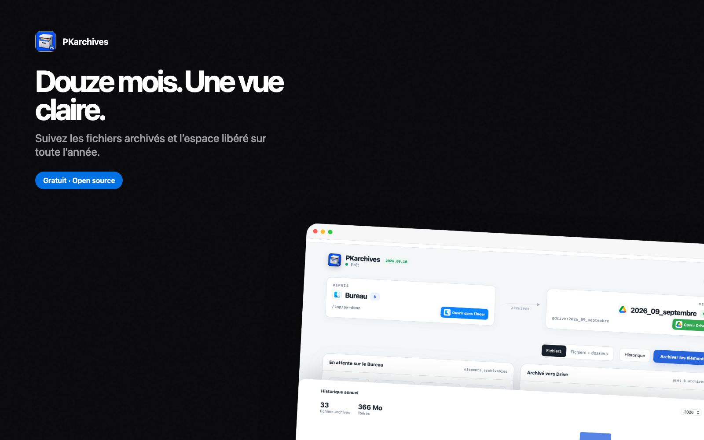

### Dossiers synchronisés — build Dev locale

Le nouveau mode est disponible dans les sources et la build Dev, **pas encore dans les téléchargements Stable ci-dessous**. L’archivage du Bureau reste un mode séparé ; la CLI/TUI ne propose pas encore la synchronisation.

1. L’app démarre sur **Archives**, premier onglet (**⌘1**), pour le nettoyage mensuel du Bureau. La navigation **Archives / Synchronisation / Réglages** est regroupée à droite, séparée du titre PKarchives, avec le même format pour les trois boutons. Choisir **Synchronisation**, identifié « En arrière-plan » (**⌘2**), puis **Créer une paire**. Les tâches de synchro continuent indépendamment de l’onglet affiché. La liste **Dossiers liés** montre les dossiers Mac reliés à Drive ; **Voir l’historique** ouvre les rapports sans sélecteur segmenté.
2. L’écran affiche d’abord un **bloc de statut unique** : titre d’état, boutons **Actualiser tout** (comparaison de toutes les paires, aucun transfert) et **Synchroniser tout**, progression condensée de l’exécution en cours (une ligne de métriques, une ligne de bilan, une barre), **dernier contrôle vérifié et prochain contrôle automatique sur une ligne**, puis la cadence en note fine — les explications longues sont en info-bulle sur le titre. Fonctionnement en arrière-plan via l’icône 📦 tant que PKarchives est actif : changements Mac contrôlés 45 s après modification, Drive environ chaque heure et au réveil ; avec le lancement à l’ouverture de session (**Réglages → Général**), la synchronisation peut remplacer l’app Google Drive. En dessous, **les paires se trient selon leur état** : celle en cours en premier, puis la file, puis celles qui réclament une action, puis celles au repos. Les panneaux **Depuis / Vers** conservent les compteurs à envoyer, à rapatrier et à supprimer, avec détail au clic ; **Actualiser les fichiers** compare sans transfert, **Synchroniser maintenant** lance une exécution réelle (première fusion confirmée explicitement). Après un contrôle vérifié, les compteurs valent zéro à la date du contrôle ; sinon « — » indique une valeur inconnue, et aucun ancien plan ne redevient une liste de transferts à effectuer. Le bilan des exécutions distingue les fichiers envoyés, rapatriés et supprimés. L’inventaire et la gestion des paires restent dans **Réglages → Synchronisation**.
   **Bureau et archivage** : le Bureau et ses sous-dossiers peuvent être liés à une paire — espace de travail synchronisé, pendant que l’archivage mensuel vide le Bureau vers ses dossiers `AAAA_MM_mois`. Archivage et synchronisation ne tournent jamais en même temps (verrou commun, y compris pour `archive.sh` lancé depuis un terminal). Après un archivage, la paire passe en « copie de travail à réconcilier » : **Actualiser les fichiers** liste les suppressions volontaires, puis une confirmation unique propage ce nettoyage à la copie Drive — fichiers retirés vers le dossier de récupération, Bureau entièrement vidé réconcilié par miroir. Les archives mensuelles restent dans une destination distincte, obligatoirement différente du dossier Drive de travail, et ne sont jamais modifiées par la synchronisation.
2. Dans le formulaire **Créer une paire**, choisir un dossier Mac dédié et donner un nom à la paire. Dans **Destination sur Google Drive**, laisser la connexion rclone habituelle (`gdrive`), cliquer **Ouvrir Google Drive**, ouvrir le dossier de destination, puis copier son **adresse complète depuis la barre du navigateur** et la coller dans **Lien du dossier**. Exemple : `https://drive.google.com/drive/folders/IDENTIFIANT_DU_DOSSIER`. L’app extrait l’identifiant : ne pas coller le nom du dossier, `gdrive:gdrive` ou le lien d’un fichier. Le navigateur doit être connecté au même compte Google que la connexion rclone ; coller un lien ne donne pas de droits supplémentaires. Enregistrer crée la paire, sans lancer de transfert.
   La méthode **Chemin rclone (avancé)** accepte encore un chemin relatif comme `Sync/Documents`, sans préfixe `gdrive:`. Ce chemin part de la racine du remote, **pas** du dossier d’archivage `PKARCHIVES_DRIVE_FOLDER_ID`. La configuration rclone n’est pas modifiée par la sélection d’un lien.
3. Choisir **deux sens**, **Mac vers Drive** ou **Drive vers Mac**, les exclusions et la règle de conflit.
4. **Simulation uniquement** est activé par défaut pour chaque nouvelle paire : les déclenchements automatiques et globaux restent simulés. **Actualiser les fichiers** effectue cette comparaison à la demande ; **Tout simuler** reste dans le menu global lorsqu’il existe plusieurs paires. Les fichiers des deux côtés et les listings bisync actifs ne sont pas modifiés. Seuls des rapports et des listings de simulation isolés sont écrits localement. La simulation ne déclare jamais une sauvegarde vérifiée et n’active pas les transferts réels.
5. Examiner les compteurs et leurs tiroirs de détail, puis choisir **Synchroniser maintenant** pour cette paire (ou désactiver « Simulation uniquement » dans ses réglages). La première fusion bidirectionnelle demande toujours une confirmation explicite. **Voir l’historique** conserve les rapports et les relances.

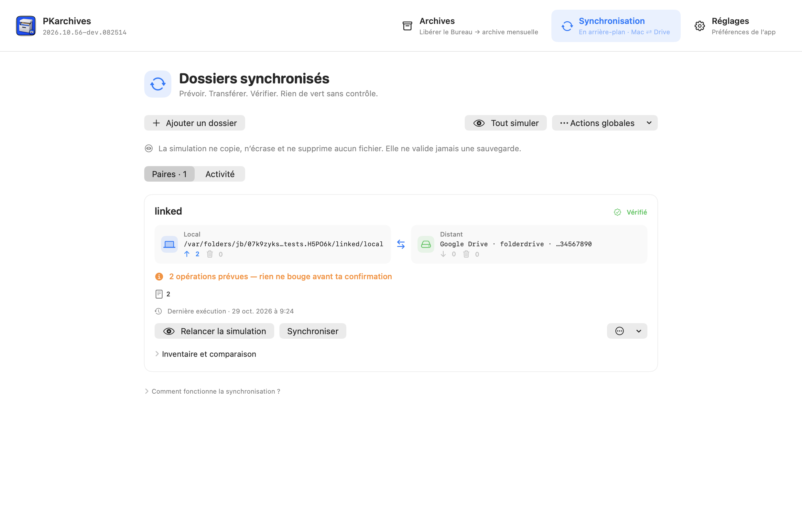

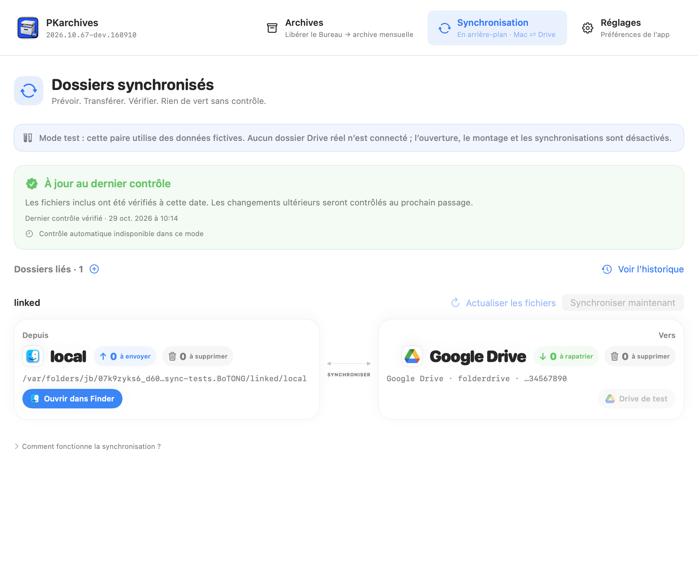

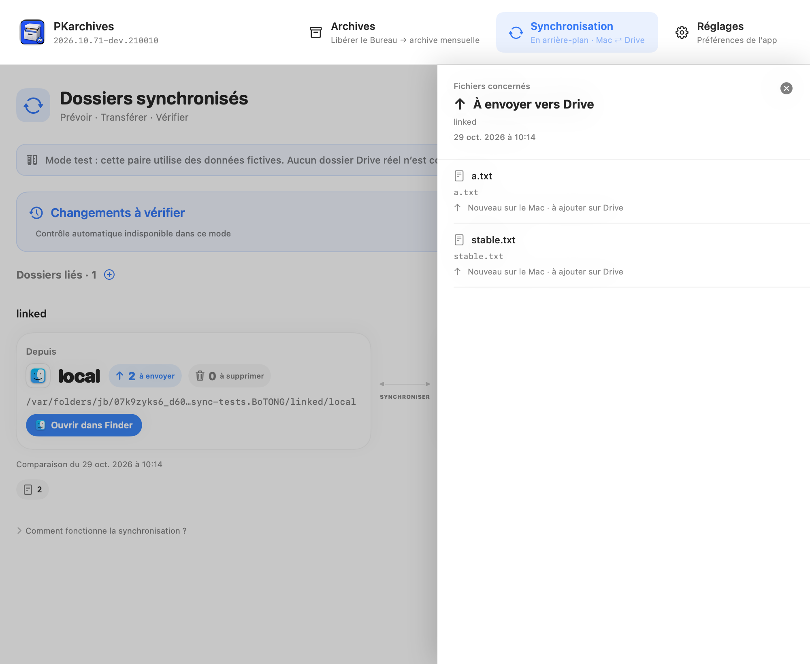

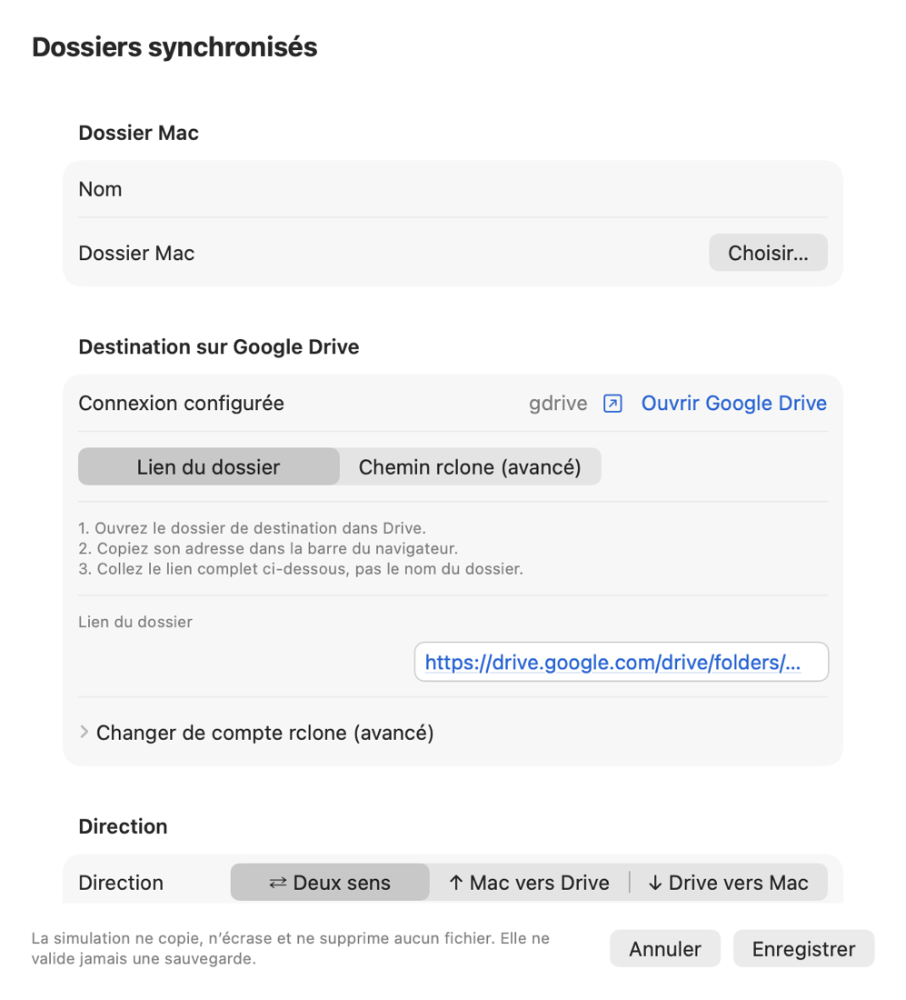

**Suivi d’exécution** : le bloc de statut affiche une progression **par action terminée**, et non par durée ni par octets : sur 16 opérations, le premier fichier terminé remplit 1/16 de la barre, le deuxième 2/16. Les trois compteurs et barres distinguent envois, rapatriements et suppressions (exemple : 3/3, 65/130, 0/234). **Pendant l’analyse**, ces compteurs s’incrémentent déjà au fil des différences repérées par rclone et affichent le nombre d’objets listés, avec la mention « repérés » ; ils restent provisoires jusqu’à la file exacte, qui prend le relais. Tant que le total est inconnu, aucun pourcentage n’est inventé. À l’ouverture de l’écran Synchronisation, les paires sans comparaison valide reçoivent une fois par session ce contrôle automatique en lecture seule, sans aucun transfert — y compris une première fusion bidirectionnelle, analysée seulement quand tu regardes l’écran. En arrière-plan, seules les paires déjà initialisées sont contrôlées au lancement. Une modification locale ou un archivage invalide l’ancien plan au lieu de réafficher des compteurs périmés. Une simulation affiche ses prévisions sans prétendre avoir transféré des fichiers ; la vérification finale affiche ses propres contrôles. Pour une synchronisation bidirectionnelle incrémentale, une comparaison préalable isolée établit le plan ; si elle mêle copies et suppressions, les copies sont effectuées et vérifiées avant le nettoyage. Cette préparation ajoute une analyse des emplacements. Un échec de copie ou de contrôle suspend le nettoyage ; des conflits ambigus ou une comparaison tronquée demandent une intervention plutôt qu’une suppression hasardeuse.

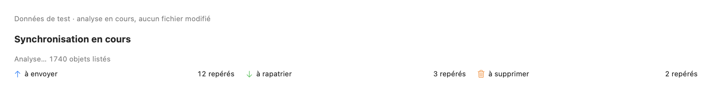

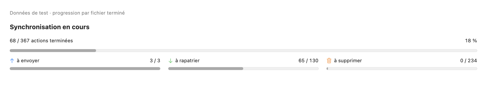

**Barre des menus** : clic gauche, clic droit ou survol de 550 ms ouvrent le panneau natif, directement sur Synchronisation si des paires sont configurées. Chaque ligne se déplie : emplacements Mac ↔ Drive, état réel, simulation, synchronisation et dernier rapport. L’exécution en cours affiche progression, débit, fichiers restants, temps restant et arrêt direct. **Synchroniser tout** respecte le mode simulation de chaque paire. Le survol ne lance aucun transfert ; son ouverture automatique se désactive dans **…** ou **Réglages → Général**.

**Réglages → Général** : lancement à l’ouverture de session (en arrière-plan, avec approbation macOS si nécessaire) et affichage de barre des menus : **Débit**, **Fichiers restants** ou **Icône seule**. Les chiffres proviennent des statistiques rclone de l’exécution en cours, actualisées environ toutes les 5 s ; les paires encore en attente ne sont pas comptées et le total peut évoluer pendant l’analyse. Analyse, simulation et vérification ont leur propre état ; au repos, seule l’icône reste affichée. L’archivage affiche le nombre d’éléments restants.

**Paires de synchronisation** : les deux panneaux **Depuis / Vers** restent côte à côte et de même taille, même à la largeur minimale de la fenêtre. Leurs chemins et leurs boutons d’ouverture occupent les mêmes rangées, les boutons étant alignés en bas. Le contenu supérieur se réorganise pour préserver la lisibilité. Après simulation, cliquez sur un compteur d’envoi, de rapatriement ou de suppression pour ouvrir directement le tiroir des fichiers concernés : chemin, sens et motif (nouveau, remplacé ou suppression propagée). L’inventaire reste distinct ; aucun second clic « Voir le détail » n’est requis. Pendant un transfert, la liaison et l’indicateur de progression s’animent selon l’état réel ; Finder, Drive et le montage du Drive sont accessibles directement hors mode test.

**Réglages → Synchronisation** : pause globale de toutes les paires (1 h), mode par défaut « Simulation uniquement » pour les nouvelles paires, et liste des paires avec activation, mode simulation et formulaire complet. Ces réglages pilotent le moteur de synchronisation ; la configuration d’archivage reste dans sa propre section.

La version complète installée (suffixe Dev compris) est visible et sélectionnable sous **PKarchives** dans le panneau de l’icône, quel que soit l’onglet choisi.

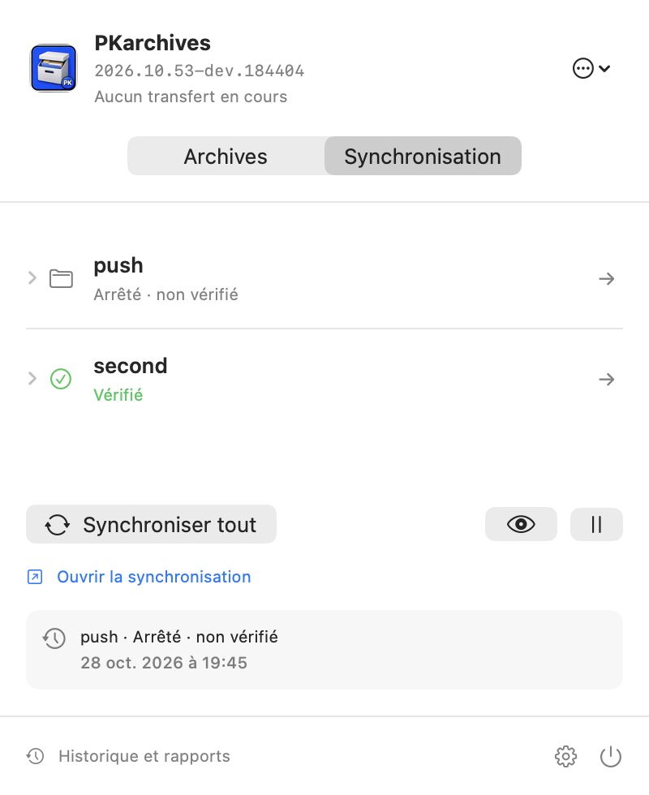

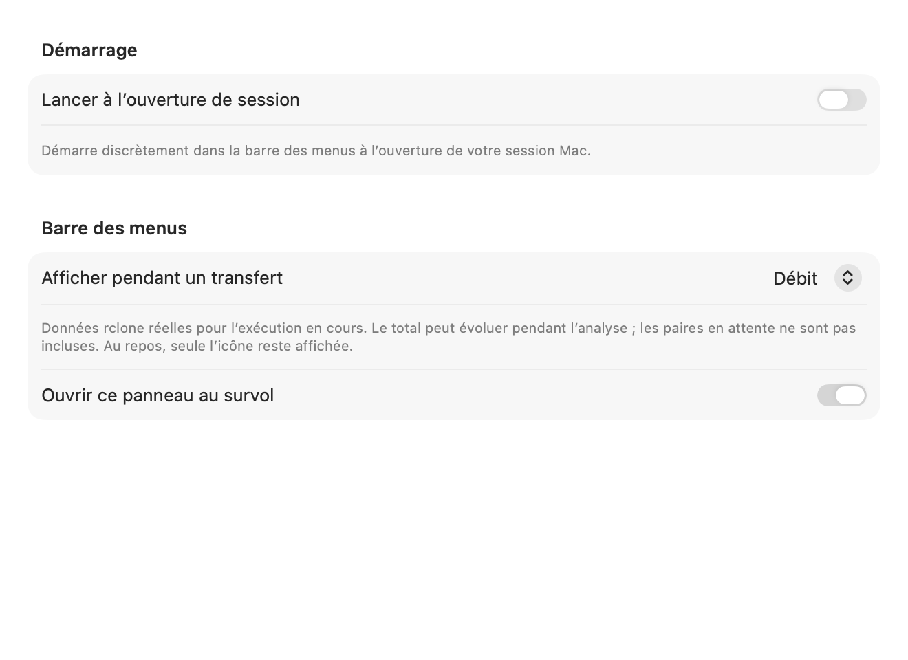

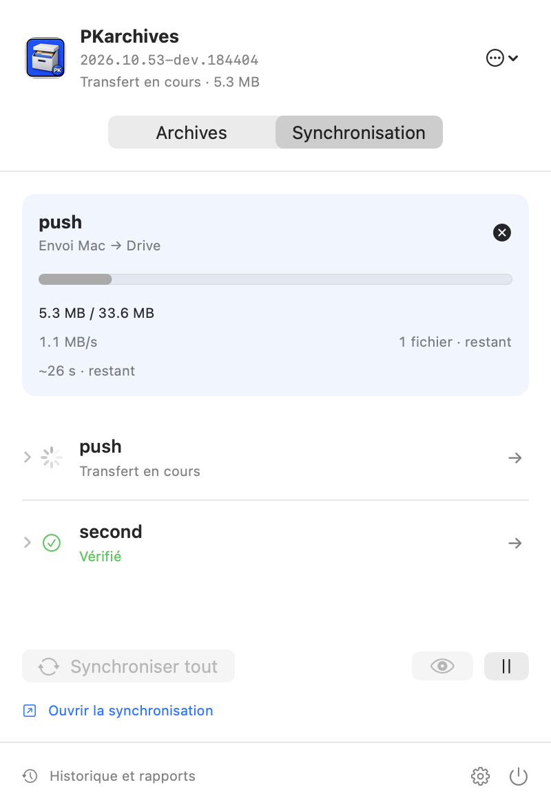

**Vérification et récupération**

- Un transfert réussi est suivi de `rclone check` : taille et empreinte des contenus inclus. Si le contrôle échoue, si les empreintes sont indisponibles ou si des changements locaux surviennent pendant le contrôle, le statut n’est **pas** « Vérifié ». La date affichée désigne le dernier contrôle réussi, pas une garantie permanente sur Drive.
- En unidirectionnel, la source remplace les fichiers différents de la destination, sans supprimer ses fichiers supplémentaires. En bidirectionnel, les changements **et suppressions** se propagent. Une synchronisation n’est pas une sauvegarde immuable.
- Les versions remplacées/supprimées sont conservées dans `.PKarchives-recovery/<paire>/<exécution>/` côté Drive et `~/Library/Application Support/PKarchives/recovery/` sur le Mac. Pour un dossier sélectionné par lien, ce sous-dossier réservé vit dans le dossier Drive sélectionné et est obligatoirement exclu des transferts et contrôles ; pour un chemin rclone classique, il vit à la racine du remote. Aucune purge automatique : surveiller l’espace utilisé.
- Chaque échec laisse un rapport et peut être relancé depuis **Activité**. Les autres paires continuent. Reprises des erreurs transitoires à 2, 5, 15, 30 puis 60 min ; une première fusion, une réparation nécessitant `resync`, un arrêt manuel et les problèmes d’accès/autorisation/dossier/sécurité attendent une décision ou une correction utilisateur. La relance réconcilie la configuration actuelle, pas une ancienne commande aveugle.
- Un quota de **requêtes API** Google (403/429) affiche sa cause réelle, distincte d’un disque Drive plein : la connexion concernée attend 15 min avant de pouvoir relancer, y compris une simulation. Il n’y a ni fusion automatique pour contourner cette erreur, ni passage de simulation à transfert réel. Si le blocage persiste, la configuration du projet OAuth peut nécessiter un examen séparé ; l’app ne modifie pas les identifiants ni les quotas Google.
- Les codes couleur du terminal sont masqués. Les détails techniques et le fonctionnement général restent repliés. Les anciens rapports bruts sont conservés ; **Voir le rapport** génère une copie de lecture propre (`rapport-lecture.md`) avec le diagnostic corrigé.
- Un arrêt brutal laisse un état à recontrôler. Si un processus précédent tourne encore, le nouveau moteur bloque plutôt que lancer deux transferts concurrents. Une configuration illisible ou un journal inaccessible bloque également le moteur.
- Les dossiers chevauchant le montage Drive, les données de l’app ou une autre paire sont refusés ; le Bureau est autorisé avec une coordination dédiée. Un dossier Drive identique à la racine des archives mensuelles est refusé. Les exclusions ne sont pas sauvegardées.
- Les chevauchements de chemins locaux et de destinations directement comparables sont détectés. Deux identifiants Drive différents ne révèlent pas leur relation parent/enfant sans requête distante : choisir des dossiers Drive distincts, non imbriqués, entre les paires.
- Les liens symboliques ne sont pas suivis : un lien ignoré par rclone empêche un statut « Vérifié ». Une suppression bidirectionnelle dépassant 50 % du listing est bloquée par le garde-fou bisync, sans forçage automatique.
- Bisync peut aussi bloquer si tous les fichiers d’un côté ont changé (y compris un dossier ne contenant qu’un seul fichier modifié). L’erreur reste visible ; aucun contournement automatique avec `--force` n’est appliqué. Ce comportement reste à améliorer avant Stable.

**Légèreté et limites** : un seul rclone à la fois, 2 transferts/2 vérificateurs, petits buffers, pas de démon rclone/RC/FUSE nécessaire. FSEvents regroupe les changements locaux sur 45 s ; contrôle distant horaire et au réveil. L’app doit rester ouverte. La pause retarde les prochains départs sans arrêter le transfert courant. Les listings restent proportionnels au nombre de fichiers et la vérification lit les fichiers locaux pour calculer leurs empreintes : ce n’est pas une synchronisation distante instantanée ni une limite RAM absolue. Validation actuelle avec rclone **1.74.4**, remotes locaux isolés et petite paire réelle sur Google Drive (simulation, première fusion, réconciliation bidirectionnelle et contrôle à 0 différence). Les gros dossiers, l'OAuth expiré et les coupures réseau restent à valider avant publication Stable.

L’ouverture normale affiche Archivage. L’argument `--background` lance l’app sans fenêtre ni interface d’archivage, pour un usage dédié à la barre des menus.

**Fichiers consultables** :

- Configuration : `~/Library/Application Support/PKarchives/sync.json`.
- Délais d’attente API par connexion : `~/Library/Application Support/PKarchives/cooldowns.json` (aucun jeton OAuth).
- Comptages par paire (inventaire Statut) : `~/Library/Application Support/PKarchives/inventories.json`.
- Journal lisible : `~/Library/Logs/PKarchives/sync.log` (rotation à 512 Kio).
- Rapports : `~/Library/Logs/PKarchives/runs/<id>/rapport.md`, `operations.log` (opérations/erreurs lisibles), `run.json`, `rclone.jsonl`, `verification.txt`. L’interface conserve les 80 dernières exécutions ; les rapports détaillés restent sur disque. Ils contiennent des noms et chemins de fichiers : les relire avant de les partager.

## Installation — Mac Apple Silicon

- **DMG** : [Télécharger PKarchives pour Mac](https://github.com/mondary/Macos_PKarchives/releases/latest/download/PKarchives.dmg), puis ouvrir le DMG et glisser l'app dans Applications.
- **Installation directe** : [Télécharger l’installateur .pkg](https://github.com/mondary/Macos_PKarchives/releases/latest/download/PKarchives.pkg), puis double-cliquer sur le fichier.
- **Homebrew** : `brew install --cask mondary/tap/pkarchives`
- **curl** : `curl -fL https://github.com/mondary/Macos_PKarchives/releases/latest/download/PKarchives.pkg -o "$HOME/Downloads/PKarchives.pkg"`

Le build publié est pour Apple Silicon (arm64). L’app et l’installateur ne sont pas notariés ; macOS peut demander une autorisation à l’installation et au premier lancement.

### La CLI/TUI, partout dans le terminal

Une commande, puis `pkarchives` fonctionne depuis n'importe quel dossier :

```bash
curl -fsSL https://raw.githubusercontent.com/mondary/Macos_PKarchives/main/scripts/install-cli.sh | sh
pkarchives
```

## ⚙️ Configuration

La configuration est générée automatiquement par `scripts/setup.sh` dans `secrets/.env`.

### Variables disponibles

| Variable | Défaut | Description |
|----------|--------|-------------|
| `PKARCHIVES_DRIVE_FOLDER_ID` | *(obligatoire)* | ID du dossier Google Drive |
| `PKARCHIVES_DESKTOP_PATH` | `~/Desktop` | Dossier à archiver |
| `PKARCHIVES_DESKTOP_LINK_NAME` | `DesktopArchive` | Nom du volume monté |
| `PKARCHIVES_RCLONE_REMOTE` | `gdrive` | Nom du remote rclone |
| `PKARCHIVES_AUTO_MOUNT` | `0` | Montage optionnel au lancement et après archivage (`1` pour activer) |

Le montage manuel reste disponible dans l’interface d’archivage : `~/DesktopArchive` (volume Finder « DesktopArchive », hors du Bureau). Il est désactivé par défaut et n’est jamais requis pour la synchronisation. Un montage déjà lancé par une ancienne build n’est pas démonté automatiquement.

## 🧾 Prérequis

- macOS 14.0+
- rclone (`brew install rclone`)
- Remote rclone configuré

## 📦 Build

```bash
./scripts/build.sh
```

Build Dev : `PK_DEV_BUILD=1 ./scripts/build.sh`. En environnement CLT 27 sans SwiftUIMacros, le script utilise le SDK 26.5 s’il est déjà installé ; `PK_MACOS_SDK` permet de choisir explicitement un SDK compatible.

Tests locaux isolés, sans accès au compte Drive ni à la configuration utilisateur :

```bash
bash scripts/test-sync.sh
```

Les tests exécutent rclone réellement contre un remote alias pointant vers des dossiers temporaires, avec cas d’erreurs injectées. Ils couvrent dry run, push/pull/bisync, vérification, conflits, récupération, relance, annulation, pause, verrous et FSEvents.

## Licence

PKarchives est distribué sous licence [MIT](LICENSE), qui autorise notamment l'usage commercial et la redistribution sous réserve de conserver la notice de copyright et de licence.

## 📋 Voir le [CHANGELOG](CHANGELOG.md) pour l'historique complet

## 🔗 Liens

- [Landing](store/website/index.html) · [film de présentation](store/media/ultracrea2-promo.mp4) · [anciennes versions](store/archive)
- [Google Drive](https://drive.google.com)
- [rclone](https://rclone.org/)
- ❤️ Soutenir ce projet sur [Ko-fi](https://ko-fi.com/pouark)
