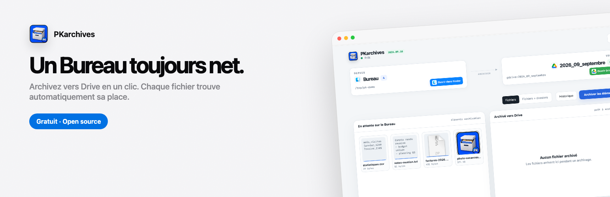
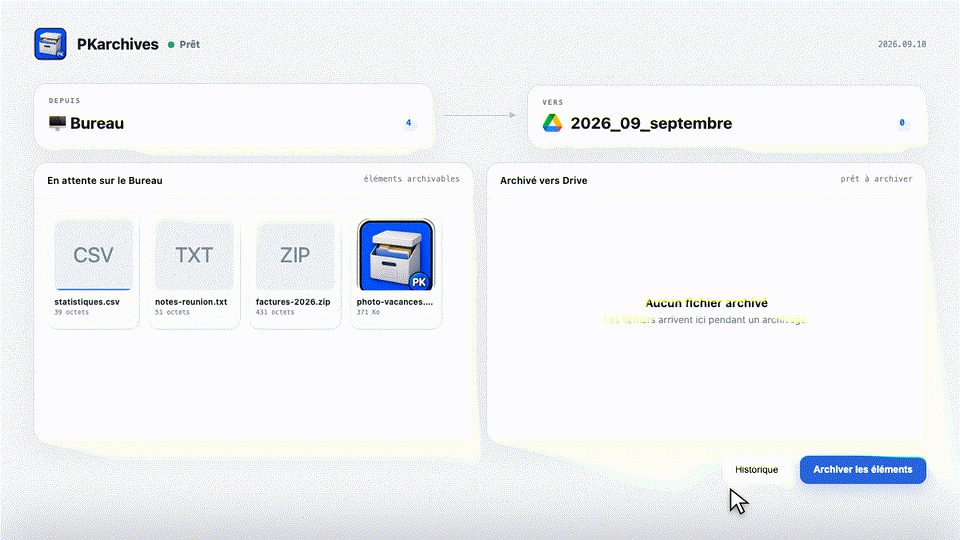
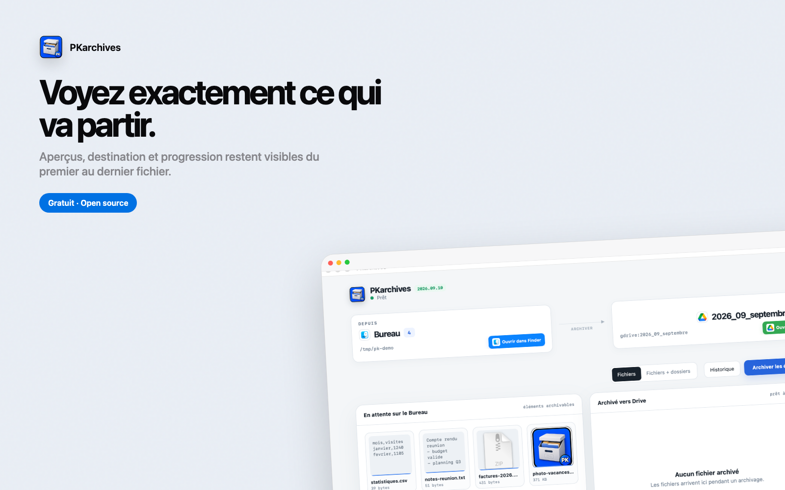
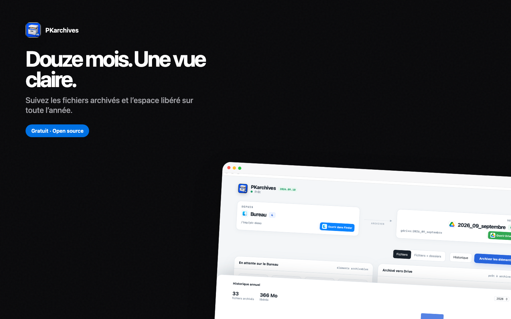
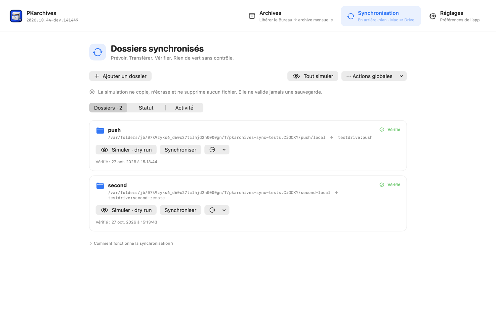
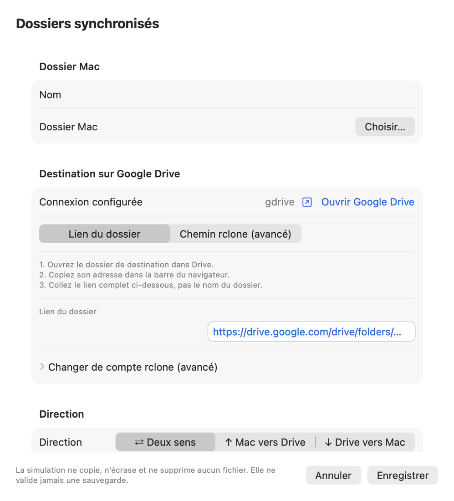
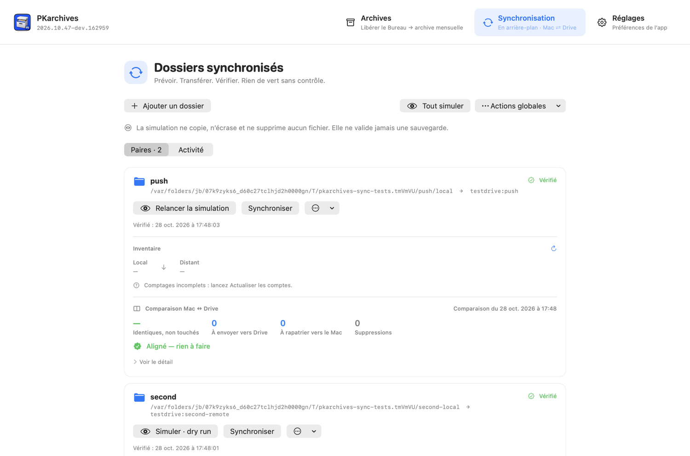
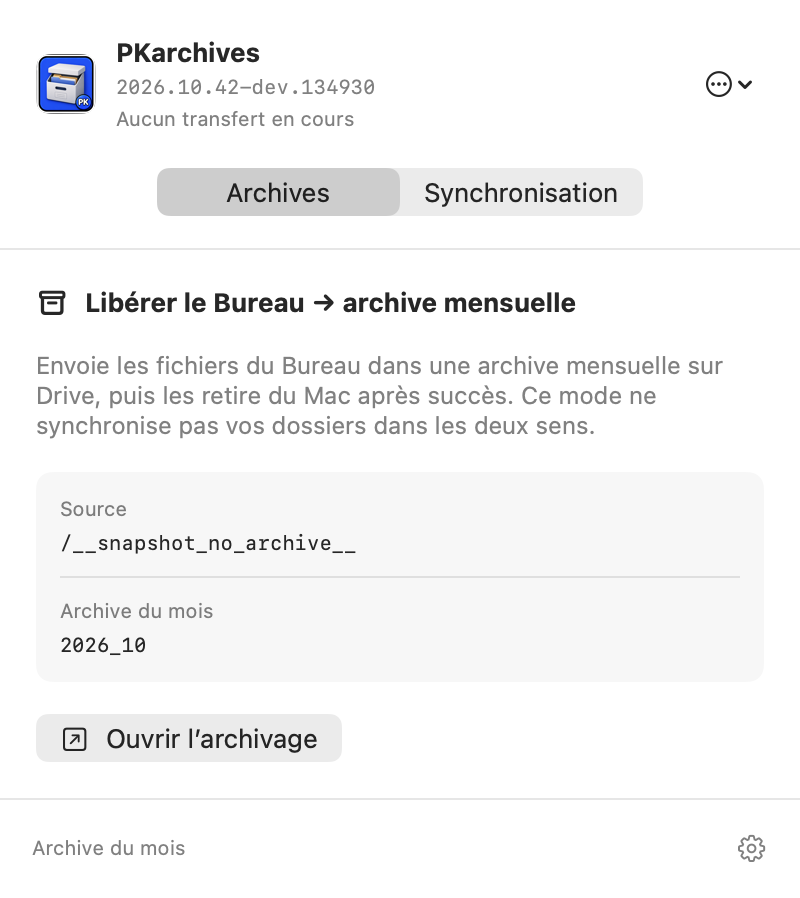

# PKarchives



[🇫🇷 FR](README.md) · [🇬🇧 EN](README_en.md)

**Project version: 2026.10.49** · Available app: 2026.10.27 · [Changelog](CHANGELOG.md) · [MIT License](LICENSE)

Archive your Desktop to Google Drive via rclone, with a macOS app and a CLI/TUI.



## Structure

```text
src/
├── macos/       # SwiftUI/menu bar app
├── cli/         # Go/TUI application
└── shared/      # Shared archive script

release/
├── macos/       # PKarchives-<YYYY.MM.PATCH>.app
└── cli/         # pkarchives binary
```

## ✅ Features

- Native macOS menu bar (SwiftUI)
- Go CLI/TUI interface
- Upload to Google Drive via rclone
- Automatic monthly archiving (`YYYY_MM_month`)
- Auto-delete after upload
- Files and folders support
- Real-time progress bar
- Native settings with search, language selection, PK project library, support, and version information
- About compares the installed app with the latest Stable and Dev builds, showing per-channel status and manually checking a freshly fetched feed
- Dedicated Credits & Inspirations settings section linking to tools, dependencies, and reference projects
- macOS Folders mode (Dev, unpublished): ⇄/↑/↓ sync, dry-run previews, content verification and replayable history



## 🧠 Usage

### First-time setup (automated)

```bash
./scripts/setup.sh
```

The interactive script guides you through:
1. Entering your Google Drive Folder ID
2. Configuring the folder to archive (default: `~/Desktop`)
3. Setting the rclone remote name (default: `gdrive`)
4. Verifying rclone is installed and configured
5. Building and launching the app

### The app

After installing from the DMG or `.pkg` (see below), the app lives in the menu bar.
To build it yourself: `./scripts/build.sh`.



### Synced folders — local Dev build

The new mode is available in the sources and Dev build, **not yet in the Stable downloads below**. Desktop archiving remains a separate mode; the CLI/TUI does not offer folder sync yet.

1. The app starts on **Archives**, the first tab (**⌘1**), for monthly Desktop cleanup. **Archives / Synchronization / Settings** are grouped on the right, separate from the PKarchives title, with matching styling for all three buttons. Choose **Synchronization**, marked “In the background” (**⌘2**), then **Add folder**. Sync jobs continue independently of the displayed tab. The tab offers two views: **Pairs** (each pair with state, inventory, comparison and actions) and **Activity** (reports).
2. The **Pairs** view shows the **queue** while a run is active, then for each pair (current run with progress, waiting pairs in order) then, for each pair: current state, mode, last run, last verified check, next attempt, and an **inventory**. A preview produces a **Mac ↔ Drive comparison**: identical untouched files, to send, to bring back, deletions on each side and conflicts, with an explicit verdict and per-file details. The inventory **gap** is highlighted: “Aligned” or an orange delta with a **duration estimate** at a 4 MB/s reference, explicitly an approximation that does not replace a preview. Counting respects the Google quota cooldown (remote deferred 15 min after a refusal) and never starts a second rclone during a transfer; counts persist across restarts.
2. Choose a dedicated Mac folder. Under **Google Drive destination**, keep the usual rclone connection (`gdrive`), click **Open Google Drive**, open the destination folder, copy its **full address from the browser bar**, and paste it into **Folder link**. Example: `https://drive.google.com/drive/folders/FOLDER_IDENTIFIER`. The app extracts the ID: do not paste the folder name, `gdrive:gdrive` or a file link. The browser must use the same Google account as the rclone connection; pasting a link does not grant additional access.
   **rclone path (advanced)** still accepts a relative path such as `Sync/Documents`, without the `gdrive:` prefix. It starts at the remote root, **not** the `PKARCHIVES_DRIVE_FOLDER_ID` archive folder. Selecting a folder link does not change rclone configuration.
3. Choose **two-way**, **Mac to Drive** or **Drive to Mac**, exclusions and a conflict policy.
4. **Preview only** is enabled by default for every new pair: automatic and global runs remain previews. **Preview · dry run** and **Preview all** are also available at any time. Neither side’s files nor the live bisync listings are changed. Only local reports and isolated preview listings are written. A preview never declares a backup verified or enables real transfers.
5. Inspect **Activity → View report**, then confirm a real run for this pair (or disable “Preview only” in its settings). The first two-way merge always requires explicit confirmation.







**Run feedback**: during a sync, a banner shows the current direction, files done / planned, volume and percentage, speed, elapsed time and rclone’s estimated remaining time, plus planned and completed operations per direction (↑ push, ↓ pull, deletions). During a preview nothing is transferred, but the comparison and its volumes stay visible.

**Menu bar**: left-click, right-click or a 550 ms hover opens the same native panel, with Synchronization/Archiving tabs, actual folder states, activity and direct access to the window and reports. Hover never triggers transfers. Automatic opening can be disabled in the panel’s **…** menu; a hover-opened panel closes when the pointer leaves it. Both modes remain directly accessible in the main window without going through settings.

**Settings → Synchronization**: global pause of all pairs (1 h), default “Preview only” mode for new pairs, and the pair list with enable/preview switches and the full form. These settings drive the sync engine; archiving configuration stays in its own section.

The full installed version (including its Dev suffix) is visible and selectable under **PKarchives** in the icon’s panel, whichever tab is selected.



**Verification and recovery**

- Successful transfers are followed by `rclone check`: size and hashes of included contents. A failed check, unavailable hashes or local changes during verification prevent a **Verified** status. The displayed date is the last successful check, not a permanent guarantee about Drive.
- One-way mode replaces differing destination files from the source, without deleting additional destination files. Two-way mode propagates changes **and deletions**. Sync is not an immutable backup.
- Replaced/deleted versions are retained in `.PKarchives-recovery/<pair>/<run>/` on Drive and `~/Library/Application Support/PKarchives/recovery/` on the Mac. For folder-link destinations, this reserved directory lives inside the selected Drive folder and is always excluded from transfers/checks; for traditional rclone paths, it lives at the remote root. No automatic purge: monitor disk/quota usage.
- Each failure leaves a report and can be retried from **Activity**. Other pairs continue. Transient errors retry at 2, 5, 15, 30, then 60 min; initial merges, repairs requiring `resync`, manual stops and access/authorization/folder/safety issues await a user decision or correction. A retry reconciles the current configuration, not an obsolete command.
- A Google **API request quota** error (403/429) shows its actual cause, distinct from full Drive storage: the affected connection waits 15 min before retrying, including previews. There is no automatic merge to bypass this error, nor a switch from preview to real transfer. Persistent blocks may require separately reviewing the OAuth project configuration; the app does not change credentials or Google quotas.
- Terminal color codes are hidden. Technical details and general explanations stay collapsed. Historical raw reports are preserved; **View report** generates a clean reading copy (`rapport-lecture.md`) with the corrected diagnosis.
- Abrupt termination leaves a state requiring a new check. If the previous process is still running, the engine blocks rather than launching concurrent transfers. Unreadable configuration or inaccessible logs also block the engine.
- Folders overlapping the archive Desktop, Drive mount, app data or another pair are rejected. Excluded files are not backed up.
- Local paths and directly comparable destinations are checked for overlap. Different Drive IDs do not reveal their parent/child relationship without a remote query: choose distinct, non-nested Drive folders across pairs.
- Symbolic links are not followed: a link skipped by rclone prevents a Verified status. Two-way deletions exceeding 50% of the listing are blocked by the bisync safety guard, without automatic force.
- Bisync may also stop when all files on one side have changed (including a folder with just one modified file). The error stays visible; there is no automatic `--force` bypass. This behavior still needs improvement before Stable.

**Resource usage and limits**: one rclone at a time, 2 transfers/2 checkers, small buffers, no required rclone/RC/FUSE daemon. FSEvents batches local changes over 45 s; remote checks are hourly and after wake. The app must stay open. Pause delays new runs without stopping the current transfer. Listings still scale with file count and verification reads local files to compute hashes: this is neither instantaneous remote sync nor a hard RAM limit. Current validation uses rclone **1.74.4**, isolated local remotes and a small real Google Drive pair (preview, initial merge, two-way reconciliation and a zero-difference check). Large folders, expired OAuth and network interruptions still need testing before a Stable release.

Normal launch opens Archiving. The `--background` argument starts the app without a window or archive UI for menu-bar-only use.

**Inspectable files**:

- Configuration: `~/Library/Application Support/PKarchives/sync.json`.
- Per-connection API cooldowns: `~/Library/Application Support/PKarchives/cooldowns.json` (no OAuth tokens).
- Per-pair counts (Status inventory): `~/Library/Application Support/PKarchives/inventories.json`.
- Readable journal: `~/Library/Logs/PKarchives/sync.log` (512 KiB rotation).
- Reports: `~/Library/Logs/PKarchives/runs/<id>/rapport.md`, `operations.log` (readable operations/errors), `run.json`, `rclone.jsonl`, `verification.txt`. The UI retains the latest 80 runs; detailed reports remain on disk. These contain filenames and paths: review them before sharing.

## Installation — Apple Silicon Mac

- **DMG**: [Download PKarchives for Mac](https://github.com/mondary/Macos_PKarchives/releases/latest/download/PKarchives.dmg), then open the DMG and drag the app to Applications.
- **Direct installer**: [Download the .pkg installer](https://github.com/mondary/Macos_PKarchives/releases/latest/download/PKarchives.pkg), then double-click the file.
- **Homebrew**: `brew install --cask mondary/tap/pkarchives`
- **curl**: `curl -fL https://github.com/mondary/Macos_PKarchives/releases/latest/download/PKarchives.pkg -o "$HOME/Downloads/PKarchives.pkg"`

The published build targets Apple Silicon (arm64). The app and installer are not notarized; macOS may ask you to approve the installation and first launch.

### CLI/TUI, from anywhere in Terminal

Run this once, then use `pkarchives` from any folder:

```bash
curl -fsSL https://raw.githubusercontent.com/mondary/Macos_PKarchives/main/scripts/install-cli.sh | sh
pkarchives
```

## ⚙️ Configuration

Configuration is automatically generated by `scripts/setup.sh` in `secrets/.env`.

### Available variables

| Variable | Default | Description |
|----------|---------|-------------|
| `PKARCHIVES_DRIVE_FOLDER_ID` | *(required)* | Google Drive folder ID |
| `PKARCHIVES_DESKTOP_PATH` | `~/Desktop` | Folder to archive |
| `PKARCHIVES_DESKTOP_LINK_NAME` | `DesktopArchive` | Mounted volume name |
| `PKARCHIVES_RCLONE_REMOTE` | `gdrive` | rclone remote name |
| `PKARCHIVES_AUTO_MOUNT` | `0` | Optional mount at launch and after archiving (`1` to enable) |

Manual mounting remains available in the archive interface: `~/DesktopArchive` (Finder volume “DesktopArchive”, outside the Desktop). It is disabled by default and never required for sync. Mounts already started by an older build are not automatically unmounted.

## 🧾 Requirements

- macOS 14.0+
- rclone (`brew install rclone`)
- rclone remote configured

## 📦 Build

```bash
./scripts/build.sh
```

Dev build: `PK_DEV_BUILD=1 ./scripts/build.sh`. With CLT 27 missing SwiftUIMacros, the script uses SDK 26.5 if already installed; `PK_MACOS_SDK` explicitly selects a compatible SDK.

Isolated local tests, without accessing your Drive account or user configuration:

```bash
bash scripts/test-sync.sh
```

Tests run real rclone against a remote alias backed by temporary folders, alongside injected failure cases. Coverage includes previews, push/pull/bisync, verification, conflicts, recovery, replay, cancellation, pause, locks and FSEvents.

## License

PKarchives is distributed under the [MIT License](LICENSE), which permits commercial use and redistribution provided the copyright and license notice are retained.

## 📋 See [CHANGELOG](CHANGELOG.md) for full history

## 🔗 Links

- [Landing page](store/website/index.html) · [product film](store/media/ultracrea2-promo.mp4) · [previous versions](store/archive)
- [Google Drive](https://drive.google.com)
- [rclone](https://rclone.org/)
- ❤️ Support this project on [Ko-fi](https://ko-fi.com/pouark)
